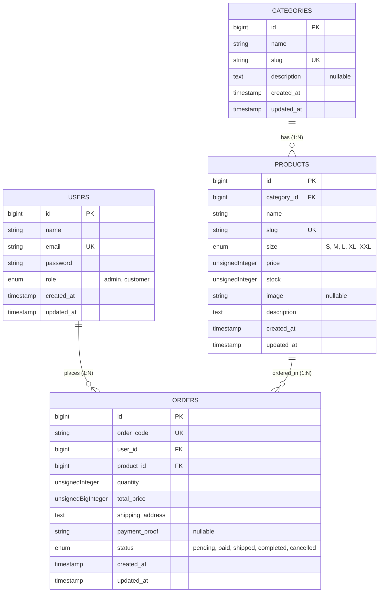

# MASTER PRODUCT REQUIREMENTS DOCUMENT (PRD) & TECHNICAL BLUEPRINT

## Project Name: TheHoodZ (THZ) Official E-Commerce & Management System

> **Instruksi Khusus untuk AI Coding Agent:**  
> Dokumen ini adalah _Single Source of Truth_ (Blueprint Utama) untuk membangun aplikasi web monolitik **TheHoodZ (THZ)**. Ikuti seluruh spesifikasi teknis, penamaan tabel, penamaan kolom, rute (routes), logika controller, aturan validasi, dan struktur tampilan secara presisi tanpa menambah kompleksitas di luar dokumen ini.

---

## 1. RINGKASAN PROYEK & TUJUAN BISNIS (TAHAP 1: ANALISIS KEBUTUHAN)

### 1.1 Latar Belakang Masalah

**TheHoodZ (THZ)** adalah _clothing brand_ yang menjual produk pakaian (_Baju/T-Shirt, Jacket, Sweater, dan Hoodie_). Saat ini THZ membutuhkan satu sistem website terpusat yang menggabungkan **Storefront (Katalog & Pembelian untuk Customer)** dan **Backoffice Dashboard (Manajemen Data & Transaksi untuk Admin)** di dalam satu aplikasi web yang sederhana, cepat, dan terstruktur.

### 1.2 Tujuan Aplikasi

1. Menyediakan katalog online interaktif bagi pelanggan untuk mencari, memfilter, dan membeli produk THZ.
2. Menyediakan proses pemesanan langsung (_Direct Checkout_) dengan fitur unggah bukti pembayaran manual yang tersimpan di penyimpanan lokal server.
3. Menyediakan Dashboard Admin terintegrasi untuk memantau grafik penjualan, total pemasukan, stok produk, serta mengelola data master dan memvalidasi pesanan pelanggan.

### 1.3 Target Pengguna & Pembagian Role (Authorization)

Aplikasi ini memiliki **2 Role** yang dibedakan melalui kolom `role` pada tabel `users`:

1. **`admin` (Pemilik / Pengelola Toko THZ)**
   - Memiliki akses penuh ke halaman `/admin/*` dan halaman publik.
   - Mengelola seluruh modul CRUD (Kategori, Produk, Pesanan, dan Pengguna).
   - Memantau ringkasan statistik bisnis dan grafik penjualan di Dashboard.
2. **`customer` (Pembeli / Pelanggan THZ)**
   - Hanya memiliki akses ke halaman katalog publik (`/`) dan halaman transaksi pelanggan (`/my-orders/*`, `/checkout/*`).
   - Dilarang mengakses seluruh rute `/admin/*` (akan di-redirect atau menampilkan `403 Forbidden`).
   - Wajib login (tanpa OTP, cukup email valid & password) untuk melakukan _Checkout_ dan mengunggah bukti pembayaran.

---

## 2. SPESIFIKASI TEKNIS & ARSITEKTUR SISTEM

### 2.1 Tech Stack Wajib

- **Framework Backend:** Laravel 10.x / 11.x (Arsitektur MVC: Model, View, Controller)
- **Bahasa Pemrograman:** PHP >= 8.1
- **Database:** MySQL atau MariaDB
- **ORM:** Laravel Eloquent ORM
- **Template Engine:** Laravel Blade (`*.blade.php`)
- **Frontend Framework:** Bootstrap 5.3 (via CDN) + Bootstrap Icons
- **Library Tabel & Grafik (via CDN):**
  - **jQuery & DataTables (Bootstrap 5 Integration):** Untuk fitur _Search, Filter, Sorting,_ dan _Pagination_ pada tabel Admin.
  - **Chart.js:** Untuk menampilkan grafik penjualan bulanan dan distribusi stok per kategori di Dashboard Admin.
- **Autentikasi & OAuth:**
  - Laravel Built-in Auth (`Auth::attempt`, `Hash::make` menggunakan `bcrypt`).
- **Penyimpanan File (File Storage):**
  - Menggunakan disk `public` lokal Laravel (`storage/app/public/products` dan `storage/app/public/payments`) yang dihubungkan ke `public/storage` melalui perintah `php artisan storage:link`.

### 2.2 Struktur Direktori MVC yang Harus Dibangun

```text
app/
├── Http/
│   ├── Controllers/
│   │   ├── AuthController.php             # Login, Register, Logout
│   │   ├── StorefrontController.php       # Katalog Publik, Detail Produk, Checkout Customer
│   │   └── Admin/
│   │       ├── DashboardController.php    # Statistik, Grafik Penjualan, Ringkasan Stok
│   │       ├── CategoryController.php     # CRUD Modul 1: Kategori
│   │       ├── ProductController.php      # CRUD Modul 2: Produk + Upload Gambar
│   │       ├── OrderController.php        # CRUD Modul 3: Pesanan + Verifikasi Bukti Bayar
│   │       └── UserController.php         # User Management + Pengaturan Role
│   └── Middleware/
│       └── RoleMiddleware.php             # Proteksi route berdasarkan role (admin / customer)
├── Models/
│   ├── User.php
│   ├── Category.php
│   ├── Product.php
│   └── Order.php
database/
├── migrations/
│   ├── 2014_10_12_000000_create_users_table.php
│   ├── 2026_01_01_000001_create_categories_table.php
│   ├── 2026_01_01_000002_create_products_table.php
│   └── 2026_01_01_000003_create_orders_table.php
└── seeders/
    └── DatabaseSeeder.php                 # Data awal Admin, Customer, 4 Kategori THZ, Produk, & Sample Order
resources/
└── views/
    ├── layouts/
    │   ├── app.blade.php                  # Layout Storefront (Navbar Customer + Footer)
    │   └── admin.blade.php                # Layout Dashboard Admin (Sidebar + Topbar Bootstrap 5)
    ├── auth/
    │   ├── login.blade.php
    │   └── register.blade.php
    ├── storefront/
    │   ├── index.blade.php                # Halaman Utama Katalog THZ (Search, Filter, Pagination)
    │   ├── show.blade.php                 # Detail Produk & Form Direct Checkout
    │   └── my-orders.blade.php            # Riwayat Pesanan Customer & Upload Bukti Pembayaran
    └── admin/
        ├── dashboard.blade.php            # Halaman Utama Admin (Cards, Grafik Chart.js, Tabel Terbaru)
        ├── categories/                    # index.blade.php, create.blade.php, edit.blade.php
        ├── products/                      # index.blade.php, create.blade.php, edit.blade.php
        ├── orders/                        # index.blade.php, show.blade.php, create.blade.php, edit.blade.php
        └── users/                         # index.blade.php, create.blade.php, edit.blade.php
```

---

## 3. PERANCANGAN ALUR APLIKASI / USER FLOW (TAHAP 2)

### 3.1 Alur Autentikasi & Pengalihan Role (Role-Based Redirect)

1. Pengguna mengakses `/login` atau `/register`.
2. Saat **Register**, pengguna mengisi `name`, `email`, `password`, dan `password_confirmation`.
   - Sistem memvalidasi format email (`required|email|unique:users,email`) tanpa OTP.
   - Password wajib di-_hash_ menggunakan `Hash::make()`.
   - Kolom `role` otomatis diisi `'customer'`.
3. Saat **Login**:
   - Jika `Auth::user()->role === 'admin'`, arahkan (_redirect_) ke `/admin/dashboard`.
   - Jika `Auth::user()->role === 'customer'`, arahkan (_redirect_) ke halaman katalog `/`.

### 3.2 Alur Pembelian Pelanggan (Customer Direct Checkout Flow)

1. **Penjelajahan Katalog:** Customer membuka halaman `/`, mencari produk (misal: _"Oversized Hoodie"_), atau memfilter berdasarkan kategori (_Baju, Jacket, Sweater, Hoodie_).
2. **Pemilihan Produk:** Customer mengklik produk dan masuk ke `/product/{slug}`.
3. **Proses Checkout:**
   - Jika belum login, tombol beli mengarahkan Customer ke `/login`.
   - Jika sudah login, Customer mengisi form _Checkout_:
     - Jumlah beli (`quantity`, tidak boleh melebihi `stock` produk).
     - Alamat lengkap pengiriman (`shipping_address`).
     - Unggah foto bukti transfer pembayaran (`payment_proof` berupa file gambar JPG/PNG maks 2MB).
4. **Penyimpanan Transaksi (Database Transaction):**
   - Sistem membuat kode unik pesanan `order_code` (format: `THZ-YYYYMMDD-XXXX`).
   - Sistem menghitung `total_price = product.price * quantity`.
   - Sistem mengurangi stok produk: `product.stock = product.stock - quantity`.
   - Jika `payment_proof` diunggah saat checkout, status awal adalah `'pending'` (menunggu verifikasi Admin). Customer juga dapat mengunggah ulang bukti bayar di halaman `/my-orders` selama status masih `'pending'`.
5. **Verifikasi Admin:**
   - Admin membuka `/admin/orders`, melihat foto bukti bayar, dan mengubah status pesanan menjadi `'paid'` (Sudah Dibayar), `'shipped'` (Dikirim), `'completed'` (Selesai), atau `'cancelled'` (Dibatalkan — jika dibatalkan, stok produk otomatis dikembalikan).

---

## 4. ENTITY RELATIONSHIP DIAGRAM (ERD) & STRUKTUR TABEL (TAHAP 2 & 3)

### 4.1 Diagram Relasi Entitas (ERD Mermaid)



### 4.2 Spesifikasi Detail 4 Tabel Database (Migration Schema)

#### Tabel 1: `users`

Digunakan untuk autentikasi, otorisasi role, dan manajemen pengguna.
| Nama Kolom | Tipe Data Laravel Migration | Atribut / Constraint | Keterangan |
| :--- | :--- | :--- | :--- |
| `id` | `$table->id()` | Primary Key, Auto Increment | ID unik pengguna |
| `name` | `$table->string('name')` | Not Null | Nama lengkap pengguna |
| `email` | `$table->string('email')->unique()` | Unique, Not Null | Email aktif untuk login |
| `password` | `$table->string('password')` | Not Null | Password terenkripsi (`bcrypt`) |
| `role` | `$table->enum('role', ['admin', 'customer'])->default('customer')` | Default `'customer'` | Penentu hak akses pengguna |
| `remember_token` | `$table->rememberToken()` | Nullable | Token sesi login |
| `timestamps` | `$table->timestamps()` | `created_at`, `updated_at` | Waktu pembuatan & perubahan |

#### Tabel 2: `categories` (Modul CRUD 1)

Menyimpan kategori utama produk pakaian TheHoodZ (_Baju, Jacket, Sweater, Hoodie_).
| Nama Kolom | Tipe Data Laravel Migration | Atribut / Constraint | Keterangan |
| :--- | :--- | :--- | :--- |
| `id` | `$table->id()` | Primary Key, Auto Increment | ID unik kategori |
| `name` | `$table->string('name', 100)` | Not Null | Nama kategori (contoh: `Hoodie`) |
| `slug` | `$table->string('slug', 120)->unique()` | Unique, Not Null | Slug URL otomatis dari `Str::slug($name)` |
| `description` | `$table->text('description')->nullable()` | Nullable | Penjelasan kategori pakaian |
| `timestamps` | `$table->timestamps()` | `created_at`, `updated_at` | Waktu pembuatan & perubahan |

#### Tabel 3: `products` (Modul CRUD 2)

Menyimpan data inventaris pakaian TheHoodZ.
| Nama Kolom | Tipe Data Laravel Migration | Atribut / Constraint | Keterangan |
| :--- | :--- | :--- | :--- |
| `id` | `$table->id()` | Primary Key, Auto Increment | ID unik produk |
| `category_id` | `$table->foreignId('category_id')->constrained('categories')->onDelete('cascade')` | Foreign Key | Relasi ke tabel `categories` |
| `name` | `$table->string('name')` | Not Null | Nama produk (contoh: `THZ Boxy Heavy Hoodie`) |
| `slug` | `$table->string('slug')->unique()` | Unique, Not Null | Slug URL produk |
| `size` | `$table->enum('size', ['S', 'M', 'L', 'XL', 'XXL'])` | Not Null | Ukuran pakaian |
| `price` | `$table->unsignedInteger('price')` | Not Null | Harga satuan dalam Rupiah (contoh: `285000`) |
| `stock` | `$table->unsignedInteger('stock')->default(0)` | Not Null | Jumlah stok barang tersedia |
| `image` | `$table->string('image')->nullable()` | Nullable | Path lokal foto produk (`products/namafile.jpg`) |
| `description` | `$table->text('description')` | Not Null | Spesifikasi bahan, ukuran chart, & detail produk |
| `timestamps` | `$table->timestamps()` | `created_at`, `updated_at` | Waktu pembuatan & perubahan |

#### Tabel 4: `orders` (Modul CRUD 3)

Menyimpan data pesanan pelanggan beserta foto bukti pembayaran.
| Nama Kolom | Tipe Data Laravel Migration | Atribut / Constraint | Keterangan |
| :--- | :--- | :--- | :--- |
| `id` | `$table->id()` | Primary Key, Auto Increment | ID unik transaksi |
| `order_code` | `$table->string('order_code', 50)->unique()` | Unique, Not Null | Nomor invoice (contoh: `THZ-20261104-0001`) |
| `user_id` | `$table->foreignId('user_id')->constrained('users')->onDelete('cascade')` | Foreign Key | Relasi ke tabel `users` (Pembeli) |
| `product_id` | `$table->foreignId('product_id')->constrained('products')->onDelete('cascade')` | Foreign Key | Relasi ke tabel `products` |
| `quantity` | `$table->unsignedInteger('quantity')` | Not Null | Jumlah item yang dibeli |
| `total_price` | `$table->unsignedBigInteger('total_price')` | Not Null | Total bayar (`price * quantity`) |
| `shipping_address`| `$table->text('shipping_address')` | Not Null | Alamat lengkap pengiriman pembeli |
| `payment_proof` | `$table->string('payment_proof')->nullable()` | Nullable | Path lokal foto bukti transfer (`payments/bukti.jpg`) |
| `status` | `$table->enum('status', ['pending', 'paid', 'shipped', 'completed', 'cancelled'])->default('pending')` | Default `'pending'` | Status pesanan saat ini |
| `timestamps` | `$table->timestamps()` | `created_at`, `updated_at` | Waktu transaksi dibuat & diperbarui |

### 4.3 Definisi Relasi pada Model Eloquent

AI Agent **wajib** mendefinisikan method relasi berikut di masing-masing Model:

1. **`app/Models/User.php`**
   - `public function orders(): HasMany` $\rightarrow$ `return $this->hasMany(Order::class);`
   - `public function orderedProducts(): BelongsToMany` $\rightarrow$ `return $this->belongsToMany(Product::class, 'orders')->withPivot('quantity', 'total_price', 'status')->withTimestamps();` _(Memenuhi relasi Many-to-Many konseptual antara User dan Product melalui tabel Orders)_.
2. **`app/Models/Category.php`**
   - `public function products(): HasMany` $\rightarrow$ `return $this->hasMany(Product::class);`
3. **`app/Models/Product.php`**
   - `public function category(): BelongsTo` $\rightarrow$ `return $this->belongsTo(Category::class);`
   - `public function orders(): HasMany` $\rightarrow$ `return $this->hasMany(Order::class);`
4. **`app/Models/Order.php`**
   - `public function user(): BelongsTo` $\rightarrow$ `return $this->belongsTo(User::class);`
   - `public function product(): BelongsTo` $\rightarrow$ `return $this->belongsTo(Product::class);`

---

## 5. SPESIFIKASI FITUR, MODUL CRUD, & ATURAN VALIDASI (TAHAP 4, 5, & 6)

### 5.1 Spesifikasi Halaman Dashboard Admin (`/admin/dashboard`)

Halaman utama Admin wajib menampilkan ringkasan informasi real-time dari database:

1. **4 Summary Cards (Baris Atas):**
   - **Total Pendapatan Bersih (Rp):** `Order::whereIn('status', ['paid', 'shipped', 'completed'])->sum('total_price')`
   - **Total Pesanan Masuk:** `Order::count()` (disertai badge jumlah pesanan berstatus `pending`)
   - **Total Produk & Total Stok Pakaian:** `Product::count()` item & `Product::sum('stock')` pcs
   - **Total Pelanggan Terdaftar:** `User::where('role', 'customer')->count()`
2. **2 Grafik Visual (Baris Tengah - menggunakan Chart.js):**
   - **Grafik 1 (Line/Bar Chart):** Grafik Pemasukan & Penjualan per Bulan (6 atau 12 bulan terakhir).
   - **Grafik 2 (Doughnut Chart):** Distribusi Jumlah Stok Produk berdasarkan Kategori (_Baju, Jacket, Sweater, Hoodie_).
3. **2 Tabel Ringkasan Cepat (Baris Bawah):**
   - **5 Pesanan Terbaru:** Menampilkan kode order, nama pembeli, produk, bukti bayar, status, dan tombol aksi cepat.
   - **Peringatan Stok Menipis (Low Stock Alert):** Menampilkan daftar produk THZ dengan `stock <= 5`.

---

### 5.2 Spesifikasi Modul CRUD & Aturan Validasi Laravel

Setiap proses tambah (`store`) dan ubah (`update`) **wajib** menggunakan `$request->validate([...], [...])` dengan pesan kesalahan Bahasa Indonesia yang jelas dan ditampilkan di Blade menggunakan direktif `@error('field') <div class="invalid-feedback">{{ $message }}</div> @enderror`.

#### A. Modul CRUD 1: Manajemen Kategori (`Admin\CategoryController`)

- **Fitur Tabel:** Menampilkan No, Nama Kategori, Slug, Jumlah Produk Terkait (`withCount('products')`), Deskripsi, dan Tombol Aksi (Edit, Hapus).
- **Aturan Validasi (`store` & `update`):**
  ```php
  $request->validate([
      'name' => 'required|string|max:100|unique:categories,name,' . $categoryId,
      'description' => 'nullable|string|max:500',
  ], [
      'name.required' => 'Nama kategori wajib diisi.',
      'name.unique' => 'Nama kategori ini sudah terdaftar.',
      'name.max' => 'Nama kategori maksimal 100 karakter.',
  ]);
  ```

#### B. Modul CRUD 2: Manajemen Produk (`Admin\ProductController`)

- **Fitur Tabel:** Dilengkapi **Filter Dropdown Kategori & Ukuran**, Search, Sorting, dan Pagination (DataTables). Menampilkan Foto Produk (thumbnail), Nama Produk, Kategori, Ukuran (`badge`), Harga (`Rp ` + `number_format`), Stok, dan Tombol Aksi.
- **Pengelolaan File Gambar:**
  - Saat `store`: Simpan ke `$request->file('image')->store('products', 'public')`.
  - Saat `update`: Jika ada gambar baru yang diunggah, hapus file gambar lama menggunakan `Storage::disk('public')->delete($product->image)` lalu simpan gambar baru.
  - Saat `destroy`: Hapus file gambar dari `Storage::disk('public')` sebelum menghapus record database.
- **Aturan Validasi (`store` & `update`):**
  ```php
  $request->validate([
      'category_id' => 'required|exists:categories,id',
      'name'        => 'required|string|max:255',
      'size'        => 'required|in:S,M,L,XL,XXL',
      'price'       => 'required|integer|min:1000',
      'stock'       => 'required|integer|min:0',
      'image'       => ($isUpdate ? 'nullable' : 'required') . '|image|mimes:jpeg,png,jpg,webp|max:2048',
      'description' => 'required|string|min:10',
  ], [
      'category_id.required' => 'Kategori produk wajib dipilih.',
      'name.required'        => 'Nama produk wajib diisi.',
      'size.in'              => 'Ukuran harus salah satu dari: S, M, L, XL, atau XXL.',
      'price.min'            => 'Harga produk minimal Rp 1.000.',
      'stock.min'            => 'Stok produk tidak boleh bernilai negatif.',
      'image.required'       => 'Foto produk wajib diunggah.',
      'image.image'          => 'File yang diunggah harus berupa gambar.',
      'image.mimes'          => 'Format gambar harus jpeg, png, jpg, atau webp.',
      'image.max'            => 'Ukuran gambar maksimal 2MB.',
      'description.required' => 'Deskripsi produk wajib diisi (minimal 10 karakter).',
  ]);
  ```

#### C. Modul CRUD 3: Manajemen Pesanan (`Admin\OrderController` & `StorefrontController`)

- **Fitur di Admin:**
  - Tabel daftar pesanan dengan **Filter Status Pesanan** (`pending`, `paid`, `shipped`, `completed`, `cancelled`), Search, Sorting, dan Pagination.
  - Melihat pratinjau (Modal/Lightbox) foto bukti pembayaran (`payment_proof`).
  - Membuat pesanan manual dari dashboard Admin (`create`/`store`), mengubah status pesanan & bukti bayar (`edit`/`update`), serta menghapus pesanan (`destroy`).
- **Logika Stok Otomatis:**
  - Saat pesanan dibuat: Kurangi `stock` produk sebesar `quantity`.
  - Saat status pesanan diubah menjadi `'cancelled'`: Kembalikan `stock` produk sebesar `quantity` (hanya jika status sebelumnya bukan `'cancelled'`).
- **Aturan Validasi Checkout / Tambah Pesanan:**
  ```php
  $request->validate([
      'product_id'       => 'required|exists:products,id',
      'quantity'         => 'required|integer|min:1|max:' . $product->stock,
      'shipping_address' => 'required|string|min:15|max:500',
      'payment_proof'    => 'required|image|mimes:jpeg,png,jpg,webp|max:2048',
  ], [
      'quantity.max'              => 'Jumlah pembelian melebihi stok yang tersedia (' . $product->stock . ' pcs).',
      'shipping_address.required' => 'Alamat pengiriman lengkap wajib diisi.',
      'shipping_address.min'      => 'Alamat pengiriman terlalu singkat (minimal 15 karakter).',
      'payment_proof.required'    => 'Bukti transfer pembayaran wajib diunggah.',
      'payment_proof.image'       => 'Bukti pembayaran harus berupa file gambar.',
      'payment_proof.max'         => 'Ukuran file bukti pembayaran maksimal 2MB.',
  ]);
  ```

#### D. Modul Manajemen Pengguna (`Admin\UserController`)

- **Fitur:** Admin dapat melihat daftar seluruh pengguna, menambah akun baru, mengubah nama/email/password/role (`admin` atau `customer`), dan menghapus pengguna (Admin tidak boleh menghapus akunnya sendiri yang sedang login).
- **Aturan Validasi (`store` & `update`):**
  ```php
  $request->validate([
      'name'     => 'required|string|max:255',
      'email'    => 'required|email:rfc,dns|max:255|unique:users,email,' . $userId,
      'role'     => 'required|in:admin,customer',
      'password' => ($isUpdate ? 'nullable' : 'required') . '|string|min:8|confirmed',
  ]);
  ```

---

## 6. DAFTAR ROUTE & PROTEKSI MIDDLEWARE (`routes/web.php`)

### 6.1 Implementasi `RoleMiddleware`

Buat middleware `app/Http/Middleware/RoleMiddleware.php` dan daftarkan alias `'role'` pada `bootstrap/app.php` (Laravel 11) atau `app/Http/Kernel.php` (Laravel 10):

```php
public function handle(Request $request, Closure $next, string ...$roles): Response
{
    if (!auth()->check()) {
        return redirect()->route('login')->with('error', 'Silakan login terlebih dahulu.');
    }

    if (!in_array(auth()->user()->role, $roles)) {
        abort(403, 'Akses Ditolak: Anda tidak memiliki izin untuk mengakses halaman ini.');
    }

    return $next($request);
}
```

### 6.2 Pemetaan Lengkap Rute Aplikasi (`routes/web.php`)

| Method     | URI                               | Nama Route           | Controller & Method                | Middleware                    |
| :--------- | :-------------------------------- | :------------------- | :--------------------------------- | :---------------------------- |
| `GET`      | `/`                               | `home`               | `StorefrontController@index`       | Public (`web`)                |
| `GET`      | `/product/{slug}`                 | `product.show`       | `StorefrontController@show`        | Public (`web`)                |
| `GET`      | `/login`                          | `login`              | `AuthController@showLogin`         | `guest`                       |
| `POST`     | `/login`                          | `login.post`         | `AuthController@login`             | `guest`                       |
| `GET`      | `/register`                       | `register`           | `AuthController@showRegister`      | `guest`                       |
| `POST`     | `/register`                       | `register.post`      | `AuthController@register`          | `guest`                       |
| `POST`     | `/logout`                         | `logout`             | `AuthController@logout`            | `auth`                        |
| `POST`     | `/checkout/{product}`             | `checkout.store`     | `StorefrontController@checkout`    | `auth`, `role:customer,admin` |
| `GET`      | `/my-orders`                      | `my-orders.index`    | `StorefrontController@myOrders`    | `auth`, `role:customer,admin` |
| `PUT`      | `/my-orders/{order}/upload-proof` | `my-orders.upload`   | `StorefrontController@uploadProof` | `auth`, `role:customer,admin` |
| `GET`      | `/admin/dashboard`                | `admin.dashboard`    | `Admin\DashboardController@index`  | `auth`, `role:admin`          |
| `RESOURCE` | `/admin/categories`               | `admin.categories.*` | `Admin\CategoryController`         | `auth`, `role:admin`          |
| `RESOURCE` | `/admin/products`                 | `admin.products.*`   | `Admin\ProductController`          | `auth`, `role:admin`          |
| `RESOURCE` | `/admin/orders`                   | `admin.orders.*`     | `Admin\OrderController`            | `auth`, `role:admin`          |
| `RESOURCE` | `/admin/users`                    | `admin.users.*`      | `Admin\UserController`             | `auth`, `role:admin`          |

---

## 7. SPESIFIKASI DESAIN ANTARMUKA (UI/UX DESIGN SYSTEM & VISUAL BLUEPRINT)

> **Instruksi Khusus untuk AI Coding Agent (Frontend & Blade Implementation):**
> Aplikasi **TheHoodZ (THZ)** menggunakan **Dual-Dark Aesthetic System** di atas Bootstrap 5 (`data-bs-theme="dark"` dengan kustomisasi CSS variabel).
>
> 1. **Storefront (Halaman Pelanggan)** wajib menggunakan gaya **Urban Brutalist Streetwear** (Hitam Pekat, Tipografi Condensed Raksasa, Sudut Tajam `0px`, dan Aksen **Neon Lime `#D4FF00`**).
> 2. **Backoffice (Dashboard Admin)** wajib menggunakan gaya **Sleek Matte Dark SaaS UI** (Hitam Matte `#09090B`, Card `#121215`, Border Halus `#222226`, Sudut Membulat `12px`, dan Aksen **Emerald `#10B981`**).

---

### 7.1 DESIGN SYSTEM 1: STOREFRONT & LANDING PAGE PELANGGAN (URBAN STREETWEAR THEME)

Referensi visual utama menggunakan konsep **"RULE THE STREETS / BUILT DIFFERENT"**—menggabungkan fotografi _streetwear_ monokrom/kontras tinggi dengan elemen grafis _edgy_ dan warna sorotan kuning-hijau neon (_Acid Lime_).

#### A. Palet Warna Storefront (CSS Variables)

```css
:root {
  --thz-bg-primary: #0a0a0a; /* Latar belakang utama hitam pekat */
  --thz-bg-secondary: #121212; /* Latar belakang card produk & section alternatif */
  --thz-bg-paper: #ededed; /* Latar belakang terang untuk section promo kontras (Ripped Paper Section) */
  --thz-accent-neon: #d4ff00; /* Warna Aksen Utama: Acid Neon Lime (Tombol CTA, Badge, Icon Plus) */
  --thz-accent-neon-hover: #b8e600; /* Warna Hover Tombol Neon */
  --thz-text-primary: #ffffff; /* Teks judul & konten utama */
  --thz-text-muted: #9ca3af; /* Teks sub-judul & deskripsi sekunder */
  --thz-border-sharp: #262626; /* Garis pemisah tipis bertepi tajam */
}
```

#### B. Tipografi Storefront (Google Fonts)

1. **Heading Utama / Display (`<h1>`, `<h2>`, Section Title):**
   - **Font:** `'Anton'`, `'Bebas Neue'`, atau `'Oswald'` (Weights: `700`/`800`, _Condensed Uppercase_).
   - **Gaya:** Huruf kapital semua (`text-transform: uppercase`), `letter-spacing: 0.03em`, `line-height: 0.95`. Ukuran Hero Headline mencapai `4.5rem` – `6rem`.
2. **Sub-Heading / Tagline Aksen:**
   - **Font:** `'Permanent Marker'` atau `'Rock Salt'` (Font bergaya tulisan tangan/grafiti miring) berwarna `--thz-accent-neon` (`#D4FF00`) untuk teks aksen seperti _"RULE THE STREETS"_ atau _"LIMITED RELEASE"_.
3. **Body & Harga Produk:**
   - **Font:** `'Inter'` atau `'Plus Jakarta Sans'` (Weights: `400`, `500`, `600`) untuk keterbacaan optimal pada nama produk, harga, dan form checkout.

#### C. Bedah Komponen & Tata Letak Halaman Storefront (`resources/views/storefront/`)

1. **Top Navigation Bar (`partials/navbar.blade.php`):**
   - **Background:** Hitam transparan/pekat (`#0A0A0A`) dengan border bawah `1px solid #1F1F1F`.
   - **Kiri:** Brand Logo **THEHOODZ** (`font-weight: 900`, huruf tebal) + sub-teks miring _Code/Street_ (`THZ`).
   - **Tengah:** Link navigasi _uppercase_ (`SHOP`, `NEW IN`, `HOODIE`, `JACKET`, `SWEATER`, `BAJU`) dengan ukuran font `0.85rem`, `letter-spacing: 0.1em`. Saat di-_hover_, teks berubah menjadi Neon Lime `#D4FF00`.
   - **Kanan:** Ikon Search (Kaca Pembesar), Ikon Tas Belanja / Pesanan Saya dengan **Badge Bulat Neon Lime (`#D4FF00`)** bertuliskan angka hitam tebal, dan tombol Login / Dashboard.

2. **Hero Section (`partials/hero.blade.php`):**
   - **Layout:** Full-width banner berlatar fotografi model _streetwear_ (memakai Hoodie/Sweater hitam THZ) dengan _dark vignette gradient_ di sisi kiri agar teks terbaca jelas.
   - **Elemen Kiri:**
     - Teks miring kuning neon: _"RULE THE STREETS"_.
     - Headline Raksasa Putih 2 Baris: **"BUILT DIFFERENT."** dengan titik kotak berwarna Neon Lime (`#D4FF00`) di akhir kalimat.
     - Sub-teks abu-abu terang: _"Streetwear that breaks rules and sets trends."_
     - **Tombol CTA Utama:** Kotak persegi panjang sudut tajam (`border-radius: 0`), background `#D4FF00`, teks hitam tebal `SHOP NOW` diikuti ikon panah kanan `→`.
   - **Elemen Kanan Bawah (Floating Promo Card):**
     - Card hitam horizontal (`background: rgba(15,15,15,0.95)`) menampilkan 2 thumbnail mini foto produk, teks _"NEW DROP: SHADOW TECH COLLECTION"_, dan tombol kotak kuning neon bertanda `+` di sudut kanan bawah.

3. **Ticker / Marquee Strip Pembatas:**
   - Baris horizontal penuh berlatar `#050505` dengan border atas-bawah `#262626`.
   - Menampilkan teks kapital berulang yang dipisahkan simbol `+` berwarna Neon Lime:
     `WORLDWIDE SHIPPING   +   EASY RETURNS   +   SECURE CHECKOUT   +   AUTHENTIC THZ GEAR`

4. **Section Katalog Produk / "NEW DROPS" (`partials/product-card.blade.php`):**
   - **Header Section:** Judul `NEW DROPS` diikuti ikon panah `→` berwarna `#D4FF00` di kiri, dan link `VIEW ALL >` di ujung kanan.
   - **Grid Produk:** 4 kolom di layar Desktop (`col-lg-3 col-md-6`), 2 kolom di layar Mobile.
   - **Desain Product Card (Wajib Presisi):**
     - Bentuk kotak tajam (`border-radius: 0`), tanpa border luar yang tebal.
     - **Area Gambar:** Rasio potret `4:5` (`aspect-ratio: 4/5`), `object-fit: cover`, latar belakang abu-abu gelap monokrom. Efek _hover_ melakukan _zoom-in_ halus (`transform: scale(1.04)`).
     - **Footer Card (Overlay / Bar Bawah Hitam):**
       - Di sisi kiri: Nama produk huruf kapital tebal (`STEALTH HOODIE`) di atas, dan harga (`Rp 320.000`) berwarna abu-abu terang di bawahnya.
       - Di sudut kanan bawah: **Tombol Kotak Persegi (`36px x 36px`) berwarna Neon Lime `#D4FF00`** dengan ikon `+` hitam di tengahnya untuk langsung menuju detail/checkout produk.

5. **Section Eksplorasi Kategori / "EXPLORE THE CULTURE":**
   - **Layout 3 Kolom Asimetris:**
     - **Kolom Kiri (Daftar Kategori Bernomor):** Kotak berborder tipis menampilkan nomor urut berwarna `#D4FF00` diikuti nama kategori:
       - `01` **BAJU / TOPS**
       - `02` **JACKET / OUTERWEAR**
       - `03` **SWEATER / CREWNECK**
       - `04` **HOODIE / HEAVYWEIGHT**
     - **Kolom Tengah:** Ikon mahkota grafiti kuning neon di atas teks besar **"EXPLORE THE CULTURE"** dengan garis coretan (_underline brush_) berwarna `#D4FF00`.
     - **Kolom Kanan:** Foto model tampak belakang memakai T-Shirt _oversized_ bergrafis kontras tinggi dengan ornamen selotip (_duct tape effect_) di sudut foto dan teks vertikal barcode `THZ // EST. 2026`.

6. **Section Highlight / Flash Highlight ("LIMITED RELEASE"):**
   - **Kontras Dual-Tone:** Sisi kiri berlatar putih keabu-abuan (`#EDEDED`) dengan efek potongan kertas sobek (_ripped paper edge_ / diagonal) yang bertemu dengan sisi kanan berlatar hitam pekat (`#0A0A0A`).
   - **Sisi Kiri (Teks Hitam di atas Latar Terang):**
     - Judul besar hitam **"SHADOW TECH"**, deskripsi singkat, **4 Kotak Countdown Timer Hitam** (`02 DAYS`, `14 HRS`, `36 MINS`, `58 SECS`), dan tombol CTA Neon Lime `SHOP COLLECTION →`.
   - **Sisi Kanan:** Foto produk unggulan (Hoodie/Jacket eksklusif THZ) dengan stiker bulat bergerigi warna `#D4FF00` bertuliskan **"ONLY 200 PIECES"**.

7. **Section Lookbook Footer ("OUTFIT INSPIRATION"):**
   - Menampilkan 4 foto _street style_ berjajar (`4 kolom`) sebagai inspirasi _mix-and-match_ produk TheHoodZ sebelum ditutup oleh Footer hitam pekat.

---

### 7.2 DESIGN SYSTEM 2: ADMIN DASHBOARD & BACKOFFICE (SLEEK MATTE DARK SAAS UI)

Referensi visual kedua (`Admin Dashboard`) mengusung estetika **Modern Dark SaaS Dashboard** yang sangat bersih, tenang di mata, berfokus pada keterbacaan data, metrik finansial, dan efisiensi manajemen CRUD.

#### A. Palet Warna Dashboard Admin (CSS Variables)

```css
:root {
  --admin-bg-canvas: #09090b; /* Latar belakang utama halaman & sidebar (Deep Matte Black) */
  --admin-bg-card: #121215; /* Latar belakang permukaan Card & Tabel (Elevated Dark Surface) */
  --admin-bg-subtle: #18181c; /* Latar belakang sub-card, input search, & menu sidebar aktif */
  --admin-border: #222226; /* Garis tepi (border) 1px untuk seluruh card, sidebar, dan tabel */
  --admin-text-main: #f4f4f5; /* Teks angka utama, judul, & nilai metrik (Crisp Off-White) */
  --admin-text-muted: #71717a; /* Label metrik, sub-teks perbandingan ("vs last month"), & menu non-aktif */
  --admin-emerald: #10b981; /* Indikator tren positif (+8.0%, +7.5% vs last month, status Paid/Completed) */
  --admin-rose: #f43f5e; /* Indikator tren negatif / alert stok menipis / status Cancelled */
  --admin-amber: #f59e0b; /* Indikator status Pending / menunggu verifikasi bukti bayar */
}
```

#### B. Tipografi & Geometri Sudut Dashboard Admin

- **Font Family:** `'Inter'`, `-apple-system`, `sans-serif` untuk seluruh teks, angka statistik, dan tabel.
- **Ukuran & Ketebalan Angka Metrik:**
  - Angka Utama Card (`Rp 30.240.000`, `129`, `24%`): `font-size: 1.85rem`, `font-weight: 600`, `letter-spacing: -0.02em`, warna `#F4F4F5`.
  - Label Judul Card (`Total Pesanan`, `Revenue over time`): `font-size: 0.825rem`, `font-weight: 500`, warna `#A1A1AA`.
- **Geometri Sudut (Border Radius):**
  - Card Utama: `border-radius: 12px`, `border: 1px solid var(--admin-border)`, `background: var(--admin-bg-card)`.
  - Sub-card & Input Search: `border-radius: 8px`.
  - Pill Badge / Tanggal Aktif: `border-radius: 9999px` (Full Pill).

#### C. Bedah Komponen & Tata Letak Dashboard Admin (`resources/views/admin/`)

1. **Left Sidebar Navigation (`layouts/partials/sidebar.blade.php`):**
   - **Lebar Tetap:** `250px` di sisi kiri, latar `#09090B`, dipisahkan oleh border kanan `1px solid #222226`.
   - **Header Sidebar:** Logo minimalis **THZ** (ikon geometris putih di kiri + ikon _sidebar toggle_ di kanan).
   - **Search Bar Cepat:** Input gelap (`#141417`) dengan ikon kaca pembesar di kiri, placeholder `Search...`, dan badge shortcut `⌘ K` di sisi kanan.
   - **Grup Menu 1 — `Platform` (Label kecil abu-abu `#71717A`):**
     - `Dashboard` (Ikon Grid — saat aktif memiliki background pill `#1C1C21` dan teks putih terang).
     - `Kategori Pakaian` (Ikon Tag / Folder — menuju CRUD Kategori).
     - `Produk THZ` (Ikon Box / Shirt — menuju CRUD Produk).
     - `Pesanan & Bukti Bayar` (Ikon Shopping Bag / Receipt — menuju CRUD Pesanan).
     - `Laporan & Stok` (Ikon Bar Chart).
   - **Grup Menu 2 — `System`:**
     - `Manajemen User` (Ikon Users / Gear — menuju CRUD Pengguna & Role).
     - `Lihat Storefront` (Ikon External Link — kembali ke katalog publik).
   - **Footer Sidebar ("Info Ringkas / Quick Status Box"):**
     - Card kecil berlatar `#141417` (`border-radius: 10px`) berisi bullet list ringkas status toko (misal: jumlah pesanan _Pending_ hari ini dan jumlah stok produk yang menipis).

2. **Baris 1: 3 Top KPI Summary Cards (`dashboard/partials/summary-cards.blade.php`):**
   - Menggunakan grid 3 kolom (`col-md-4`). Setiap card memiliki padding `20px`:
     - **Baris Atas Card:** Label metrik di kiri (misal: `Total Pesanan`, `Konversi Pembayaran`, `Stok Tersedia`) dan **Badge Tren** di ujung kanan (ikon panah atas hijau bulat + teks `+8.0%` berwarna `#10B981`, atau merah `#F43F5E` jika menurun).
     - **Baris Bawah Card:** Angka besar putih tebal di kiri (`129`) yang langsung disandingkan secara _inline_ di sebelahnya dengan teks hijau/merah kecil `+24` diikuti teks abu-abu `vs bulan lalu`.

3. **Baris 2: Main Revenue Area Chart (`dashboard/partials/charts.blade.php`):**
   - **Card Lebar Penuh (`col-12`):**
     - **Header Kiri:** Label `Revenue over time` (Pendapatan dari Waktu ke Waktu) dengan ikon info `ⓘ`, diikuti nilai total pendapatan besar di bawahnya (contoh: **`Rp 30.240.000`**).
     - **Header Kanan:** Indikator pertumbuhan `+7.5% vs bulan lalu` dengan ikon hijau `#10B981`.
     - **Visualisasi Grafik (Chart.js Line/Area Chart):**
       - Garis grafik halus (_smooth tension_ `0.35`) berwarna abu-abu terang/putih (`#E4E4E7`) dengan _fill gradient_ vertikal dari `rgba(255,255,255,0.08)` ke transparan (`rgba(18,18,21,0)`).
       - Garis bantu horizontal (_grid lines_) putus-putus sangat samar (`#1F1F23`).
       - **Floating Dark Tooltip:** Saat titik data disorot, tampilkan _hairline_ vertikal putih dan kotak _tooltip_ hitam (`#18181C`) berisi tanggal di atas dan bulatan putih + `Revenue Rp ...` di bawahnya.
       - **X-Axis Pill Highlight:** Tanggal yang sedang aktif pada sumbu X diberi background **Pill Putih (`#FFFFFF`)** dengan teks hitam tebal.

4. **Baris 3: Split Bottom Widgets (Status Pesanan & Distribusi Stok):**
   - Terbagi menjadi 2 kolom (`col-lg-6` & `col-lg-6`):
   - **Widget Kiri — `Order Status Management` (Ringkasan Status Pesanan):**
     - Memiliki _Tab Header_ minimalis dengan garis bawah putih aktif (`Status` | `Kategori` | `Verifikasi`).
     - Di bawah tab terdapat **Multi-Segment Progress Bar Horizontal** (4 segmen bar tipis dengan gradasi terang ke gelap yang merepresentasikan proporsi status `Pending`, `Paid`, `Shipped`, `Completed`).
     - Di bawahnya terdapat **Grid 2x2 Sub-Card** (`background: #16161A`, `border: 1px solid #222226`, `border-radius: 8px`). Setiap sub-card menampilkan garis indikator pendek di atas, label status (`Pending`, `Paid`, `Shipped`, `Completed`), dan jumlah pesanan tebal (`114 orders`, `62 orders`).
   - **Widget Kanan — `Stock & Category Distribution` (Grouped Bar Chart):**
     - Menampilkan persentase ketersediaan stok (`95% Ready Stock`), legenda dengan kotak indikator warna abu-abu berbeda (`■ Hoodie`, `■ Jacket`, `■ Sweater`, `■ Baju`), serta grafik batang vertikal berkelompok (_Grouped Vertical Bar Chart_ via Chart.js) dengan palet monokrom abu-abu-putih (`#E4E4E7`, `#71717A`, `#3F3F46`).

5. **Desain Tabel DataTables & Form CRUD di Halaman Admin:**
   - Seluruh halaman CRUD (`Categories`, `Products`, `Orders`, `Users`) wajib mempertahankan tema **Matte Dark (`#121215`)**:
     - Header tabel (`<thead>`) menggunakan warna teks `#71717A`, huruf kecil kapital (`font-size: 0.75rem`, `text-transform: uppercase`), dan border bawah `#222226`.
     - Baris tabel (`<tbody>`) memiliki efek _hover_ `#18181C`.
     - Input Form & Select Dropdown menggunakan background `#141417`, border `#27272A`, dan teks putih `#F4F4F5` (ketika fokus border berubah menjadi putih/abu-abu terang).

## 8. DATA AWAL WAJIB (`DatabaseSeeder.php`)

AI Agent wajib mengisi `DatabaseSeeder.php` agar aplikasi langsung siap diuji dan dipresentasikan begitu perintah `php artisan migrate --seed` dijalankan:

1. **2 Akun Pengguna Default:**
   - **Akun Admin:**
     - Name: `Admin TheHoodZ`
     - Email: `admin@thehoodz.com`
     - Password: `password123` (di-hash dengan `Hash::make('password123')`)
     - Role: `admin`
   - **Akun Customer:**
     - Name: `Budi Streetwear`
     - Email: `customer@thehoodz.com`
     - Password: `password123` (di-hash dengan `Hash::make('password123')`)
     - Role: `customer`

2. **4 Kategori Wajib TheHoodZ:**
   - `Baju` (Slug: `baju` — Deskripsi: _Koleksi T-Shirt boxy & oversized cotton combed 24s/20s_)
   - `Jacket` (Slug: `jacket` — Deskripsi: _Koleksi Coach Jacket, Varsity, dan Work Jacket THZ_)
   - `Sweater` (Slug: `sweater` — Deskripsi: _Koleksi Crewneck Sweater fleece tebal premium_)
   - `Hoodie` (Slug: `hoodie` — Deskripsi: _Koleksi Signature Heavyweight Hoodie TheHoodZ_)

3. **Minimal 8 Produk Awal (2 Produk per Kategori):**
   - Contoh: _THZ Signature Boxy Hoodie Black (Size L, Rp 320.000, Stok 25)_, _THZ Vintage Wash Crewneck Sweater (Size XL, Rp 275.000, Stok 18)_, _THZ Urban Coach Jacket Olive (Size L, Rp 350.000, Stok 12)_, _THZ Heavy Graphic Tee White (Size M, Rp 165.000, Stok 40)_, dll.
   - Sediakan gambar _placeholder_ otomatis atau fallback image yang rapi jika file lokal belum diunggah.

4. **Minimal 5 Transaksi Pesanan Awal (`orders`):**
   - Buat variasi status (`pending`, `paid`, `shipped`, `completed`) pada beberapa bulan berbeda di tahun berjalan agar **Grafik Penjualan di Dashboard Admin langsung terlihat hidup dan terisi data** saat pertama kali dibuka.

---

## 9. INSTRUKSI EKSEKUSI BERTAHAP UNTUK AI AGENT (STEP-BY-STEP EXECUTION PLAN)

Saat dokumen ini diberikan kepada AI Coding Agent, jalankan langkah-langkah berikut secara berurutan:

1. **Step 1 (Setup & Configuration):** Pastikan koneksi database di `.env` aktif, aktifkan `Paginator::useBootstrapFive()` di `AppServiceProvider`, dan jalankan `php artisan storage:link`.
2. **Step 2 (Database & Models - Tahap 3):** Buat ke-4 file Migration (`users`, `categories`, `products`, `orders`), buat ke-4 Model beserta `$fillable` dan relasi Eloquent-nya, lalu buat `DatabaseSeeder.php` dan jalankan `php artisan migrate:fresh --seed`.
3. **Step 3 (Authentication & Authorization - Tahap 6):** Buat `RoleMiddleware`, daftarkan di middleware alias, buat `AuthController` (Login, Register, Logout), dan buat view `auth/login.blade.php` serta `auth/register.blade.php`.
4. **Step 4 (Admin Dashboard & 3 Modul CRUD + User Management - Tahap 4 & 5):** Buat `DashboardController`, `CategoryController`, `ProductController`, `OrderController`, dan `UserController` lengkap dengan validasi Bahasa Indonesia, upload gambar lokal, serta halaman Blade Bootstrap 5 + DataTables + Chart.js.
5. **Step 5 (Storefront & Customer Checkout Flow):** Buat `StorefrontController` beserta halaman katalog publik, fitur filter/search/sorting/pagination, halaman detail produk, form checkout + upload bukti bayar, dan halaman riwayat pesanan pelanggan.
6. **Step 6 (Testing & Verification - Tahap 7):** Pastikan seluruh route berjalan tanpa error, uji login menggunakan `admin@thehoodz.com` dan `customer@thehoodz.com`, serta pastikan proteksi middleware berjalan sesuai spesifikasi.
