# TheHoodZ (THZ) - Official E-Commerce & Management System

> **Tugas Projek UTS Kelompok — Pemrograman Web Tingkat Mahir (Kelompok AF)**  
> **Tema Pilihan:** Sistem Informasi Penjualan (Clothing Brand & Manajemen Inventaris Terpadu)

---

## 1. Deskripsi Aplikasi

**TheHoodZ (THZ)** adalah aplikasi web monolitik _e-commerce & backoffice management system_ yang dirancang khusus untuk brand pakaian _streetwear_ (Baju/T-Shirt, Jacket, Sweater, dan Hoodie). Sistem ini mengintegrasikan dua antarmuka utama dalam satu kesatuan arsitektur MVC Laravel:

1. **Storefront (Area Pelanggan):** Antarmuka belanja publik bertema _Urban Brutalist Streetwear_ (Aksen _Acid Neon Lime `#D4FF00`_ dan tipografi _Anton / Oswald_), dilengkapi katalog dengan filter dinamis, pencarian, detail produk dengan galeri foto interaktif, formulir pembelian langsung (_Direct Checkout_), serta riwayat transaksi pelanggan beserta unggah bukti transfer.
2. **Backoffice Dashboard (Area Administrator):** Antarmuka manajemen bertema _Sleek Matte Dark SaaS UI_, menyajikan metrik KPI bisnis _real-time_, visualisasi grafik penjualan dan distribusi stok menggunakan **Chart.js**, serta pengelolaan 4 modul CRUD utama menggunakan **DataTables Bootstrap 5**.

Aplikasi dibangun dengan mematuhi prinsip _Clean Code_, standar arsitektur _Single Responsibility_, dan seluruh berkas kode terstruktur rapi di bawah batas 150 baris per file.

---

## 2. Target Pengguna & Hak Akses (Role & Authorization)

Sistem membedakan hak akses pengguna menjadi **2 Role** yang diamankan melalui `RoleMiddleware`:

| Role           | Hak Akses & Kemampuan                                                                                                                                                                                                                                                                                                                                                          | Halaman Utama        |
| :------------- | :----------------------------------------------------------------------------------------------------------------------------------------------------------------------------------------------------------------------------------------------------------------------------------------------------------------------------------------------------------------------------- | :------------------- |
| **`admin`**    | Memiliki akses penuh ke seluruh rute `/admin/*` dan halaman publik. Memantau ringkasan statistik KPI dan grafik penjualan, mengelola modul CRUD Kategori, CRUD Produk (dengan fitur _multi-image upload_ dan _live preview_), memverifikasi pesanan dan bukti bayar (dengan logika pemotongan & pengembalian stok otomatis), serta mengelola akun pengguna dan pembagian role. | `/admin/dashboard`   |
| **`customer`** | Hanya memiliki hak akses ke storefront publik (`/`), detail produk (`/product/{slug}`), serta area transaksi pelanggan (`/my-orders`). Customer wajib login untuk melakukan _checkout_ langsung dan mengunggah foto bukti transfer bank. Customer **dilarang keras** mengakses seluruh rute `/admin/*` (akan ditolak dengan status `403 Forbidden`).                           | `/` dan `/my-orders` |

---

## 3. Fitur-Fitur Utama Aplikasi (Pemenuhan Spesifikasi UTS)

1. **Dashboard Eksekutif Admin:**
    - **4 KPI Summary Cards:** Total Pendapatan Bersih (Rp), Total Pesanan Masuk (beserta badge pesanan pending), Total Produk & Stok Pakaian, serta Total Pelanggan Terdaftar.
    - **Grafik Penjualan Bulanan (Chart.js Line/Area Chart):** Menampilkan tren pemasukan selama 6 bulan terakhir dengan gradien halus dan _floating dark tooltip_.
    - **Grafik Distribusi Stok (Chart.js Doughnut Chart):** Komposisi stok barang siap jual per kategori pakaian.
    - **Pipeline Status Pesanan:** Multi-segment progress bar & status card (_Pending, Paid, Shipped, Completed_).
    - **Tabel Cepat:** 5 transaksi pesanan terbaru dan daftar produk dengan stok menipis ($\le 5$ pcs).
2. **4 Modul Manajemen Data (CRUD Lengkap):**
    - **CRUD Kategori Pakaian:** Kelola nama, slug URL otomatis, dan deskripsi kategori dengan relasi penghitungan jumlah produk.
    - **CRUD Produk Pakaian:** Kelola nama, kategori, ukuran (`S, M, L, XL, XXL`), harga satuan, stok, deskripsi, foto cover utama, dan foto galeri detail.
    - **Multi-Image Uploader & Live Preview:** Form tambah/edit produk mendukung unggah banyak foto sekaligus dengan _live preview_ instan sebelum disimpan.
    - **CRUD Pesanan & Verifikasi Bukti Bayar:** Filter pesanan berdasarkan status, pratinjau bukti transfer bank, pengubahan status pesanan, dan penyesuaian stok otomatis (_auto-restock_ saat pesanan dibatalkan).
    - **CRUD Pengguna & Role:** Penambahan akun admin/customer, pembaruan profil/password, serta proteksi keamanan agar admin yang sedang login tidak dapat menghapus akunnya sendiri.
3. **Pengelolaan Tabel Tingkat Mahir (DataTables):**
    - Seluruh tabel master admin dilengkapi fitur _Instant Search_, _Sorting_ kolom, _Pagination_, dan _Page Length Selector_.
4. **Alur Belanja Pelanggan (Customer Direct Checkout Flow):**
    - Katalog produk responsif (tampilan desktop 5 kartu per baris dan mobile 2 kolom).
    - Pencarian instan dan penyaringan berdasarkan kategori atau harga.
    - Halaman detail produk dengan galeri foto sudut pandang berbeda yang proporsional.
    - Formulir pembelian langsung (_Direct Checkout_) dengan kalkulasi total bayar dinamis dan opsi unggah bukti bayar.
    - Halaman pesanan saya dengan status transaksi dan modal unggah bukti transfer.
5. **Autentikasi & Keamanan:**
    - Registrasi akun customer (`username`, `name`, `email`, `password`).
    - Login menggunakan email dan password dengan enkripsi hash `bcrypt`.
    - Proteksi route menggunakan `auth`, `guest`, dan `RoleMiddleware`.

---

## 4. Rancangan Database & Entity Relationship Diagram (ERD)

### 4.1 Diagram Relasi Entitas (Mermaid ERD)

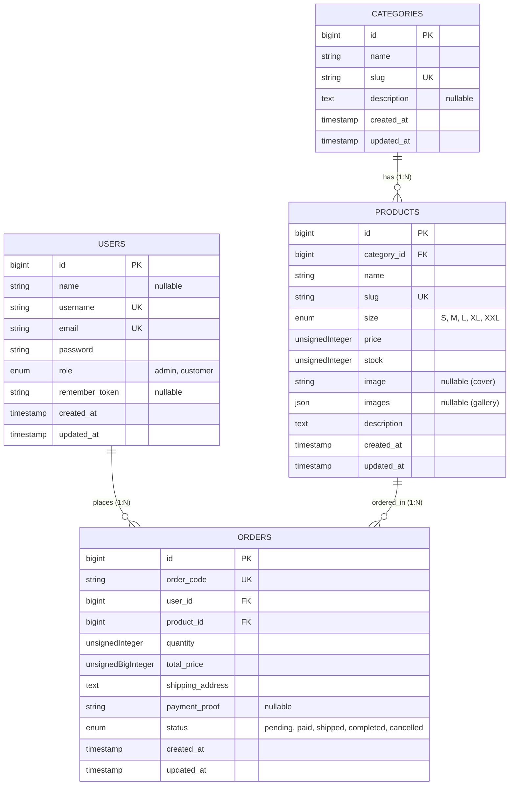

### 4.2 Spesifikasi Tabel Database

1. **`users`:** Menyimpan data kredensial login, username unik, nama pengguna, dan penentu hak akses melalui kolom enum `role` (`admin` atau `customer`).
2. **`categories`:** Menyimpan data master kategori pakaian (_Baju, Jacket, Sweater, Hoodie_) beserta slug URL otomatis.
3. **`products`:** Menyimpan katalog pakaian TheHoodZ, relasi ke kategori (`category_id`), atribut ukuran, harga, stok, path foto cover utama (`image`), dan array path foto galeri (`images` JSON).
4. **`orders`:** Menyimpan riwayat transaksi belanja langsung pelanggan, kode unik pesanan (`order_code`), relasi pembeli (`user_id`), relasi produk (`product_id`), kuantitas, total tagihan, alamat pengiriman, path foto bukti transfer (`payment_proof`), dan status pesanan.

---

## 5. Dokumentasi Screenshot Semua Fitur

### 5.1 Storefront & Alur Pelanggan

#### 1. Halaman Utama Katalog Produk (Home Storefront)

Menampilkan Hero Banner Urban Streetwear, Ticker Marquee, Filter Kategori, Pencarian, Paginasi Kustom TheHoodZ, dan Grid 5 Produk per baris.
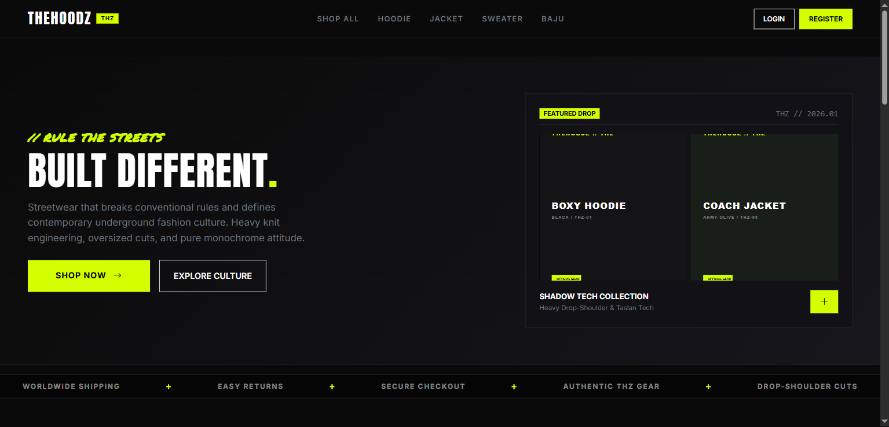

#### 2. Halaman Detail Produk & Formulir Direct Checkout

Menampilkan galeri foto produk interaktif dengan thumbnail sudut pandang berbeda, spesifikasi ukuran dan bahan, serta formulir pembelian langsung.
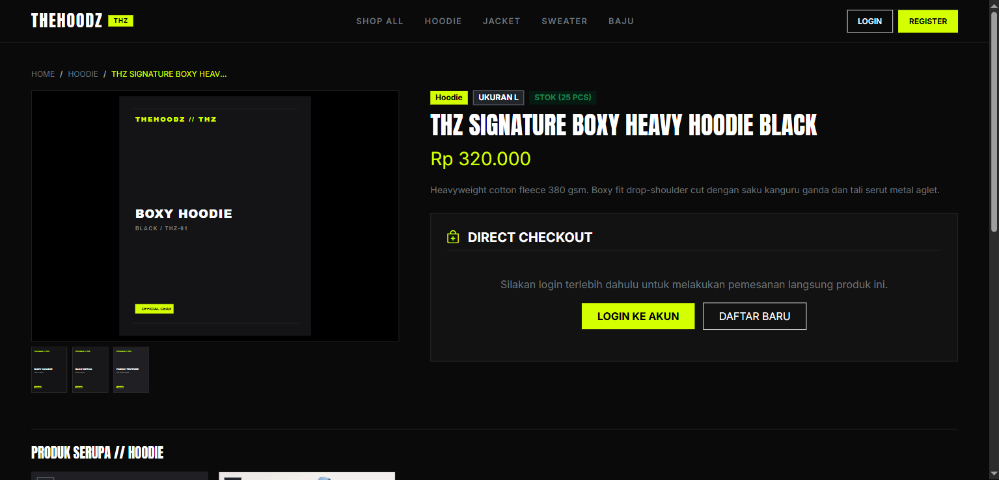

#### 3. Halaman Login Pengguna

Formulir masuk ke akun TheHoodZ untuk Administrator dan Pelanggan menggunakan email dan password.
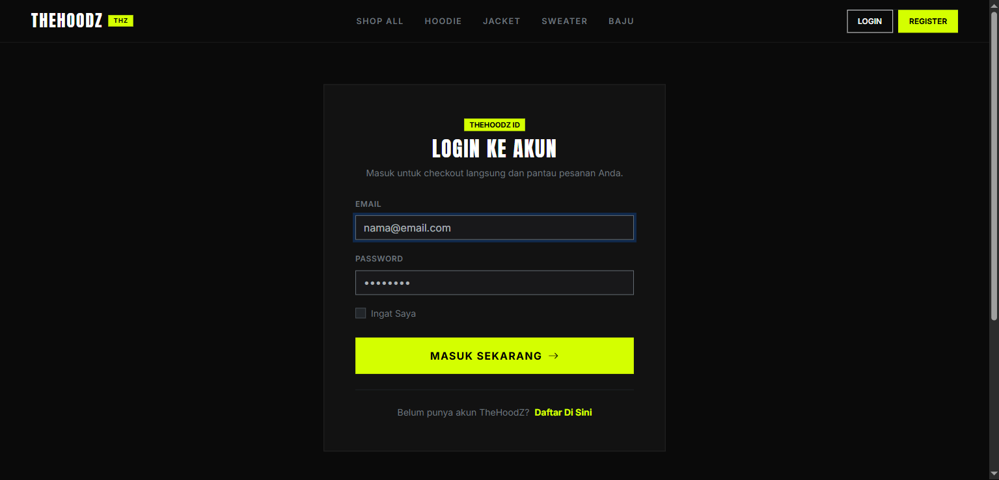

#### 4. Halaman Registrasi Pelanggan Baru

Formulir pendaftaran akun customer baru dengan validasi username unik, email, dan konfirmasi password.
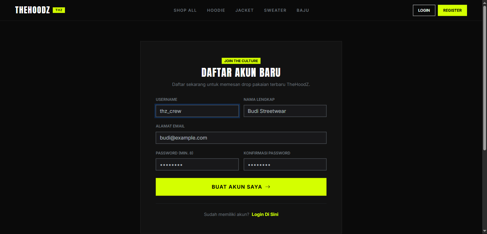

#### 5. Riwayat Pesanan Saya (Customer Order History)

Daftar seluruh transaksi yang dilakukan oleh customer yang sedang login, status pesanan (_Pending, Paid, Shipped, Completed_), serta modal unggah bukti bayar.
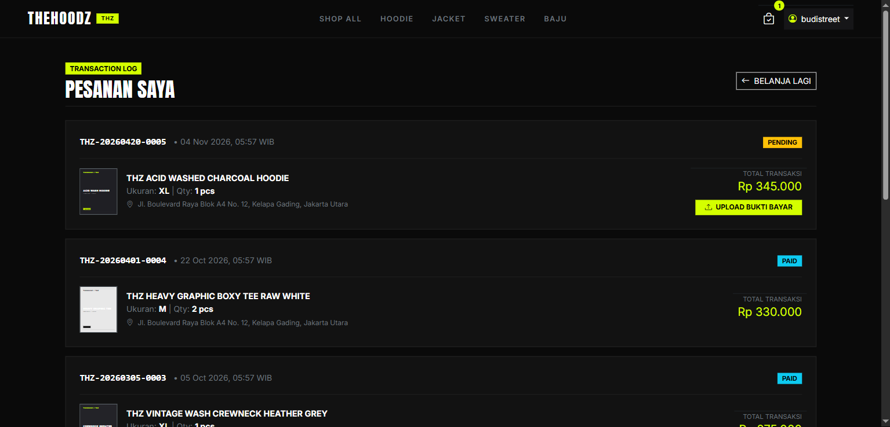

---

### 5.2 Backoffice Dashboard Admin

#### 6. Executive Dashboard Utama Admin

Menampilkan 4 KPI summary cards, grafik pendapatan bulanan (_Chart.js Area Chart_), grafik persebaran stok per kategori (_Chart.js Doughnut Chart_), pipeline status transaksi, tabel 5 pesanan terbaru, dan alert stok menipis.
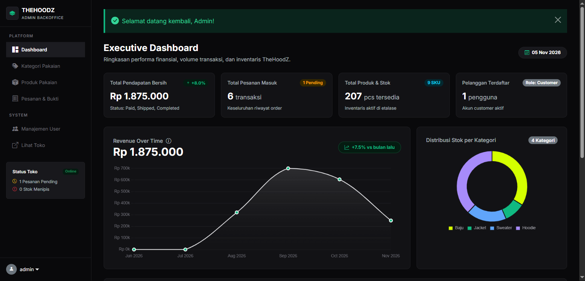

#### 7. Modul CRUD 1: Manajemen Kategori Pakaian

Daftar kategori pakaian TheHoodZ dengan integrasi DataTables (Search, Sort, Pagination), relasi jumlah produk terkait, serta tombol aksi.
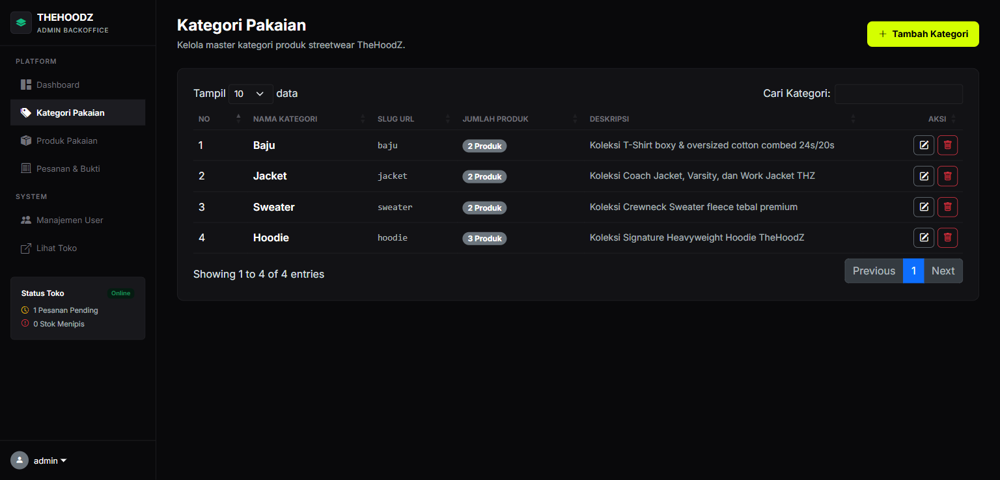

#### 8. Modul CRUD 2: Inventaris Produk Pakaian

Tabel inventaris produk pakaian lengkap dengan thumbnail foto, badge kategori, ukuran, harga satuan, stok, serta opsi preview toko, edit, dan hapus.
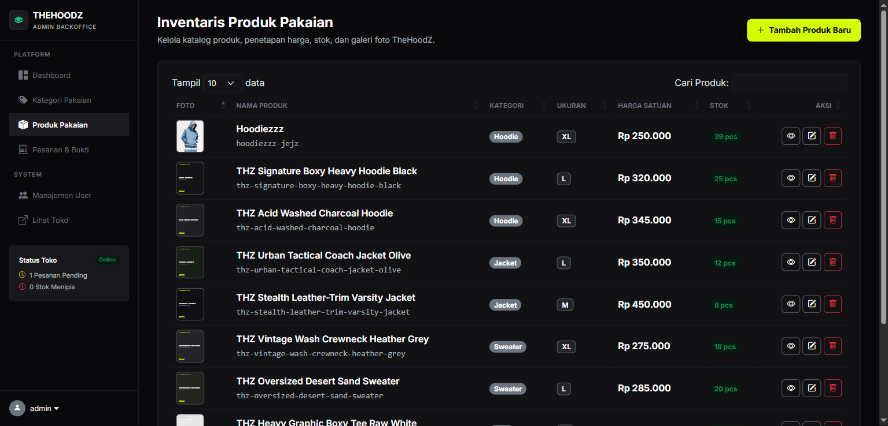

#### 9. Form Input Produk Baru dengan Multi-Image Upload & Live Preview

Formulir penambahan pakaian baru dengan fitur unggah multi-gambar, drag & drop, serta live preview otomatis dengan penanda foto cover utama vs foto galeri.
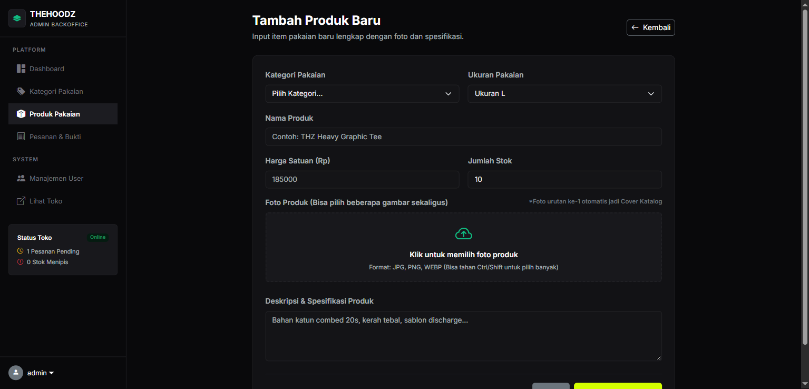

#### 10. Modul CRUD 3: Manajemen Pesanan & Verifikasi Bukti Bayar

Daftar pesanan dengan filter status cepat (_All, Pending, Paid, Shipped, Completed, Cancelled_), preview bukti transfer pelanggan, dan pengelolaan logistik.
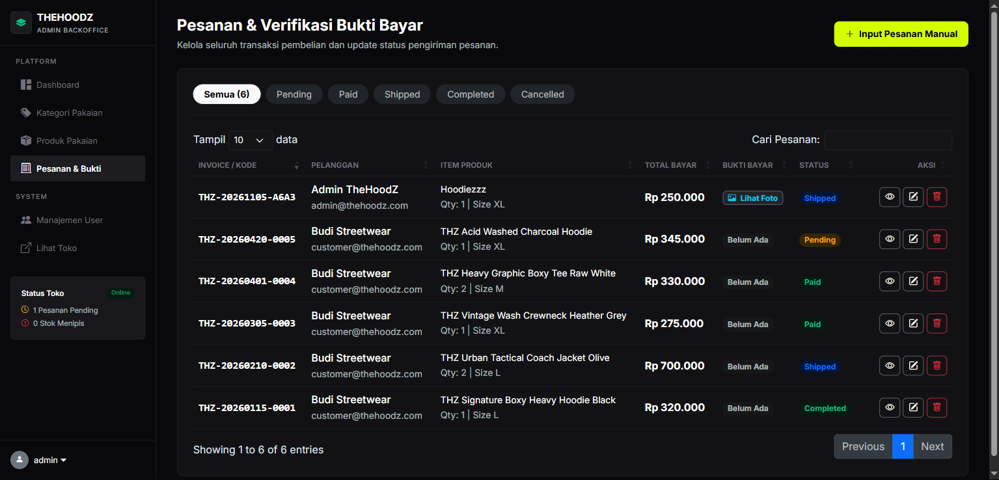

#### 11. Modul CRUD 4: Manajemen Pengguna & Otorisasi Role

Pengelolaan seluruh akun pengguna terdaftar, penambahan akun baru, pengaturan role hak akses (`admin` atau `customer`), dan proteksi keamanan akun aktif.
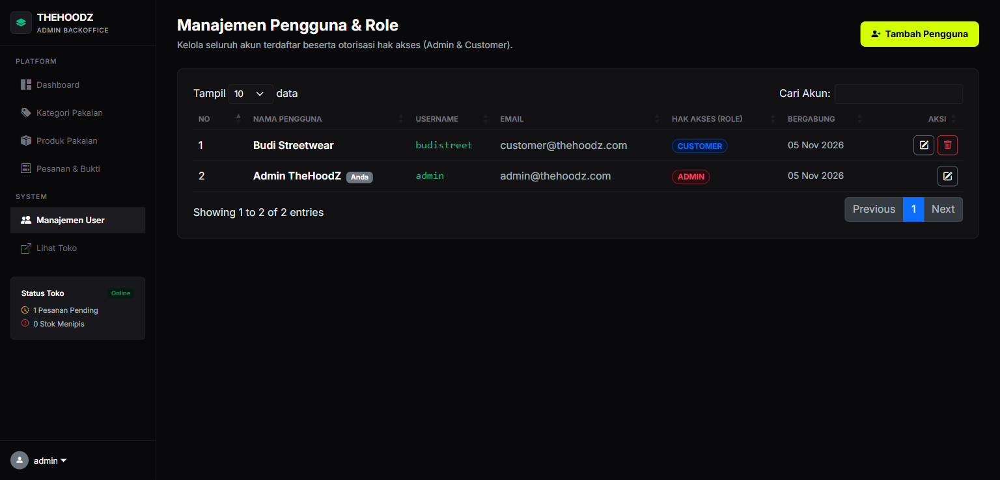

---

## 6. Petunjuk Instalasi & Menjalankan Aplikasi

### Persyaratan Sistem:

- PHP >= 8.2
- Composer >= 2.x
- MySQL / MariaDB (melalui XAMPP atau MySQL Server lokal)
- Web Browser Modern (Chrome, Edge, Firefox)

### Langkah-Langkah Menjalankan:

1. **Clone atau Buka Direktori Repositori:**

    ```bash
    cd "d:\VS Code\TheHoodZ"
    ```

2. **Pastikan Dependensi Terinstal:**

    ```bash
    composer install
    ```

3. **Konfigurasi Lingkungan (`.env`):**
   Pastikan konfigurasi database pada berkas `.env` mengarah ke database MySQL Anda:

    ```env
    APP_NAME="TheHoodZ"
    APP_ENV=local
    APP_KEY=base64:KNCDze2cSJ4X46q9Ymmf/CmzRBL2uFnty7VFKDfvvbE=
    APP_DEBUG=true
    APP_URL=http://localhost:8000

    DB_CONNECTION=mysql
    DB_HOST=127.0.0.1
    DB_PORT=3306
    DB_DATABASE=thehoodz
    DB_USERNAME=root
    DB_PASSWORD=
    ```

4. **Migrasi Database & Seeding Data Awal:**
   Jalankan perintah berikut untuk membuat struktur 4 tabel dan mengisi data awal akun, kategori, produk, serta sampel pesanan:

    ```bash
    php artisan migrate:fresh --seed
    ```

5. **Hubungkan Storage Symlink (Untuk Gambar & Bukti Bayar):**

    ```bash
    php artisan storage:link
    ```

6. **Jalankan Server Lokal Laravel:**
    ```bash
    php artisan serve
    ```
    Aplikasi dapat diakses melalui browser pada alamat: **`http://127.0.0.1:8000`**

---

## 7. Kredensial Akun untuk Pengujian & Demonstrasi

| Role Pengguna             | Alamat Email                                    | Kata Sandi         | Akses Utama                                                   |
| :------------------------ | :---------------------------------------------- | :----------------- | :------------------------------------------------------------ |
| **Administrator (Admin)** | `admin@thehoodz.com`                            | `password123`      | `http://127.0.0.1:8000/admin/dashboard`                       |
| **Pelanggan (Customer)**  | `customer@thehoodz.com`                         | `password123`      | `http://127.0.0.1:8000` dan `http://127.0.0.1:8000/my-orders` |
| **Customer Baru**         | Dapat mendaftar mandiri melalui menu `REGISTER` | Minimal 8 karakter | Langsung dialihkan ke Storefront                              |
